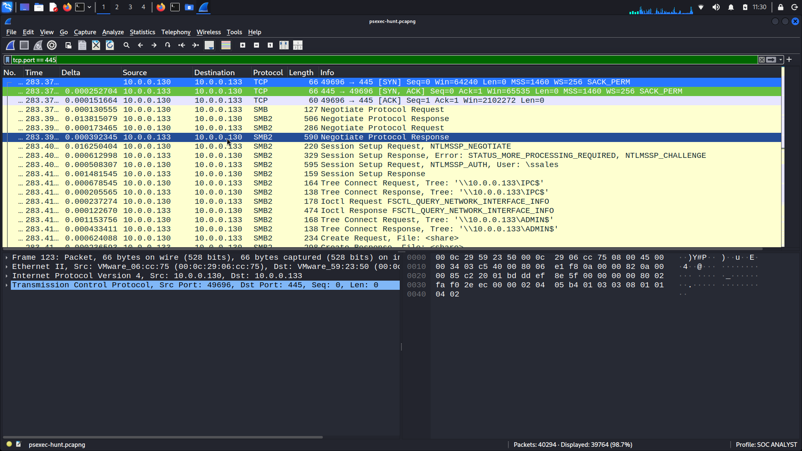
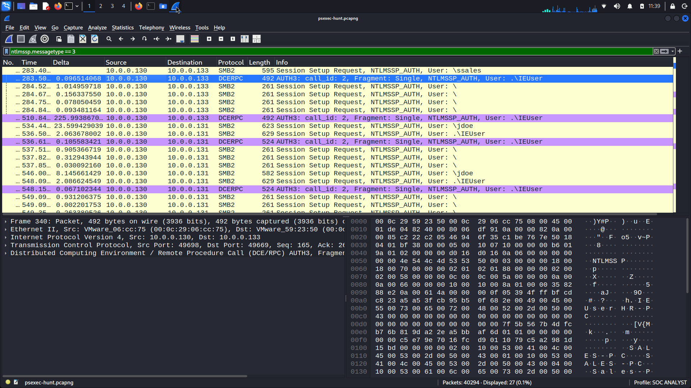
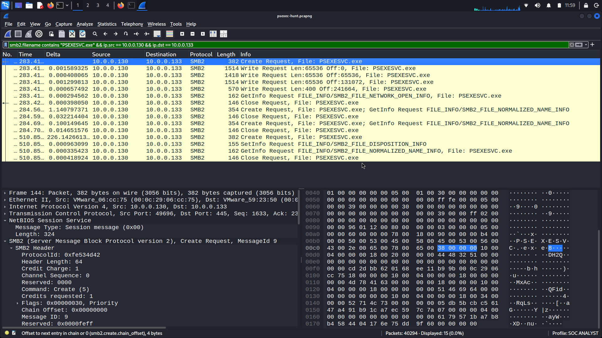

# CyberDefenders: PsExec Hunt — Network Forensics

## Overview

Investigated Windows lateral movement activity using Wireshark. Analyzed SMB2 and NTLM authentication traffic to identify the source machine, target systems, service executable transfer, and administrative share usage.

**Platform:** CyberDefenders  
**Category:** Network Forensics  
**Difficulty:** Easy  
**Tools:** Wireshark  
**Status:** Completed (7/7)

## Investigation Summary

| Detail | Finding |
|---|---|
| Capture | psexec-hunt.pcapng |
| Packets | 40,294 |
| Source IP | 10.0.0.130 |
| Initial Target IP | 10.0.0.133 |
| Initial Target Hostname | SALES-PC |
| Authentication Account | xsales |
| Service Executable | PSEXESVC.exe |
| Administrative Share | ADMIN$ |
| Communication Share | IPC$ |

## Key Findings

### 1. SMB Connection Analysis

Identified SMB communication initiated from `10.0.0.130` to `10.0.0.133` over TCP port `445`.

**Wireshark Filter:** `tcp.port == 445`

### 2. NTLM Authentication Investigation

Examined NTLMSSP authentication exchanges to identify the target hostname and authentication account.

**Filters:**
- `ntlmssp.messagetype == 2`
- `ntlmssp.messagetype == 3`

Identified the target hostname `SALES-PC` and observed authentication using the `xsales` account.

### 3. PsExec Service Executable Transfer

Observed SMB2 Create and Write requests involving `PSEXESVC.exe`, consistent with PsExec remote service deployment.

**Wireshark Filter:** `smb2.filename contains "PSEXESVC.exe" && ip.src == 10.0.0.130 && ip.dst == 10.0.0.133`

**Evidence:** Frame 144 and subsequent SMB2 Write requests.

### 4. Administrative Share Investigation

Identified two important SMB shares:

- `ADMIN$` — Used for administrative file access and executable transfer.
- `IPC$` — Used for inter-process communication.

The SMB Tree Connect requests helped identify share usage during the investigation.

### 5. Additional Lateral Movement Investigation

Observed further authentication activity involving `10.0.0.131`, indicating another system involved in the investigation.

## SOC Analyst Takeaways

- SMB traffic can provide evidence of lateral movement.
- NTLM authentication messages help identify accounts and Windows hostnames.
- PsExec activity can be investigated through service executable transfers.
- Administrative share activity should be correlated with authentication and file operations.
- Legitimate administrative tools can also be abused, so context is essential before declaring malicious activity.

## Conclusion

Completed all seven CyberDefenders questions through practical network traffic analysis. Strengthened skills in SMB forensics, Windows authentication analysis, and identifying indicators of lateral movement.

**Lab:** https://cyberdefenders.org/blueteam-ctf-challenges/psexec-hunt/

*Analysis performed using an authorized training capture.*
