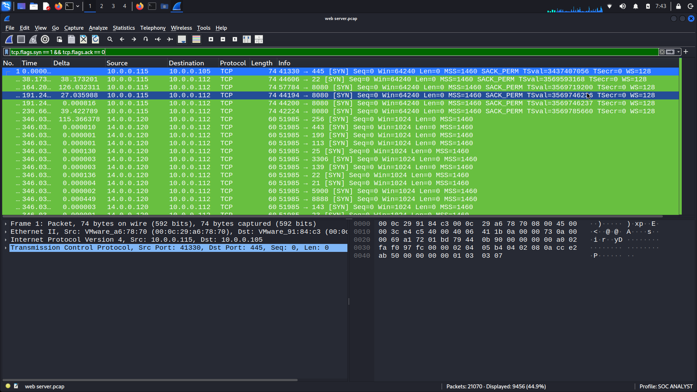
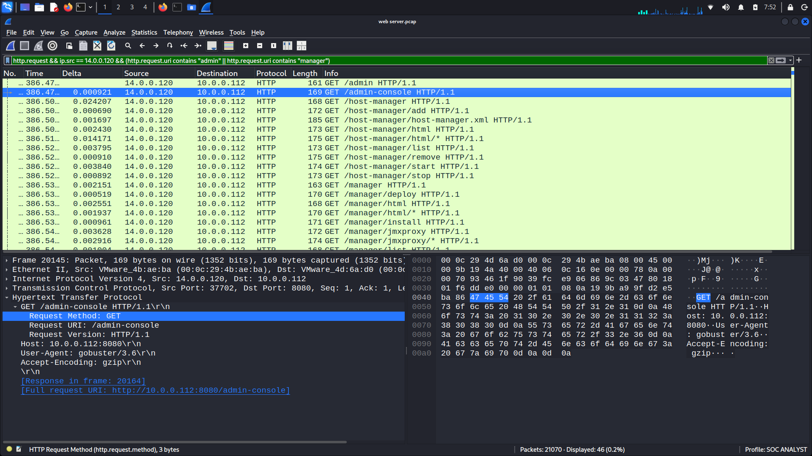
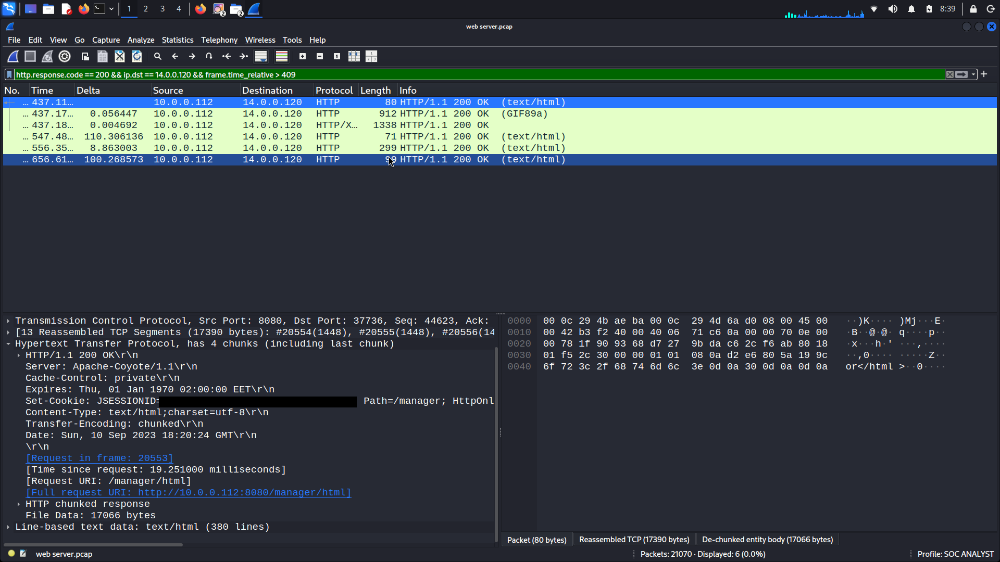
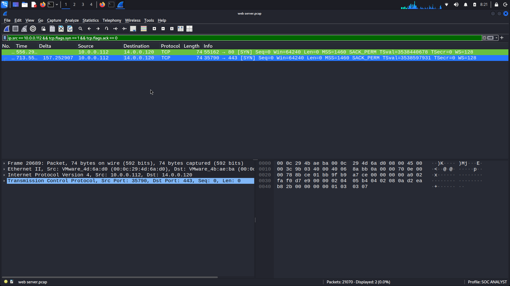

# CyberDefenders: Tomcat Takeover — Network Forensics

## Overview

Investigated an Apache Tomcat web server attack using Wireshark. Analyzed network traffic to identify reconnaissance, directory enumeration, authentication attempts, suspicious file upload activity, and an outbound callback.

- **Platform:** CyberDefenders
- **Difficulty:** Easy
- **Tools:** Wireshark
- **Capture:** web server.pcap (21,070 packets)
- **Status:** Completed (8/8)

## Investigation Findings

### 1. Port Scanning

Detected rapid TCP SYN requests from `14.0.0.120` targeting multiple ports on `10.0.0.112`.

**Filter:** `tcp.flags.syn == 1 && tcp.flags.ack == 0`

### 2. Directory Enumeration

Identified automated directory scanning through the `gobuster/3.6` User-Agent.

Discovered `/manager`, returning HTTP `302 Found` and redirecting to `/manager/`.

### 3. Authentication Analysis

Observed repeated `401 Unauthorized` responses followed by a successful `200 OK` response for `/manager/html`.

Examined HTTP Basic Authentication headers to identify the successful login. Credentials are omitted.

### 4. Suspicious File Upload

Investigated HTTP POST activity associated with the Tomcat management interface and the uploaded file.

### 5. Outbound Callback

Identified an outbound TCP connection from `10.0.0.112` to `14.0.0.120:443`, associated with the challenge's reverse shell activity.

## SOC Analyst Takeaways

- Detect port scanning through unusual TCP SYN patterns.
- Identify directory enumeration using HTTP requests and User-Agent headers.
- Investigate repeated authentication failures followed by successful access.
- Correlate suspicious file uploads with unexpected outbound connections.
- Validate findings using multiple pieces of network evidence.

## Conclusion

Completed all 8 questions through hands-on PCAP analysis, strengthening my understanding of network forensics, HTTP traffic investigation, and suspicious activity detection.

**Lab:** [CyberDefenders — Tomcat Takeover](https://cyberdefenders.org/blueteam-ctf-challenges/tomcat-takeover/)

*Authorized training environment.*
